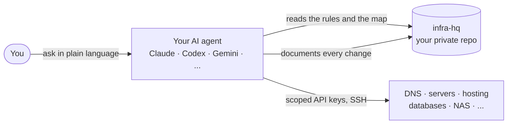

# infra-hq

**Give your AI coding agent the keys to your infrastructure, safely, and just ask.**

> *"Move my site from Vercel to my own server."*
> *"Clean up the old DNS records nobody remembers."*
> *"Why is the shop down?"*
> *"Are my databases actually backed up?"*

Your domains are registered in one place and your DNS lives in another. One site runs on Vercel, another on a VPS. There's a database somewhere, maybe a NAS at home, and a dozen dashboards you log into twice a year. Every change starts with an hour of remembering how it all fits together.

**infra-hq turns a private GitHub repo into the headquarters for all of it.** Your agent (Claude Code, Codex, Gemini CLI, Antigravity or any other agent that reads `AGENTS.md`) interviews you, connects to your services with least-privilege keys, maps everything you run, and writes it down. From then on you open your agent and ask, and it gets done.

## How it works



1. **Create your copy.** Click **Use this template**, and make the new repo **private**.
2. **Open your agent in it** and say *"Set me up."*
3. **Have a conversation.** The agent asks what you run, what you want to be able to ask for, and what must never be touched. No forms, and no assumptions about your stack beyond GitHub.
4. **Connect.** The agent tells you exactly which keys to create, with the narrowest permissions that work. You paste them into a local script, never into the chat. The agent tests every connection.
5. **Discover.** The agent walks your DNS zones, servers, apps and databases, and links each domain to its host, its app and its GitHub repo. It flags what looks wrong: dangling DNS records, missing backups, forgotten servers.
6. **Write it down.** You get a living map of your infrastructure, a to-do list of findings, and a guide for connecting your next computer.

After that, every repo you open knows where your HQ is. Ask for a DNS change while you're working on your website's code, and the agent knows how and documents it in the right place.

## What makes it different

**Works with any agent.** `AGENTS.md` is the single source of instructions. `CLAUDE.md` and `GEMINI.md` just point to it. Access goes through plain CLIs, REST APIs and SSH, so it works in every tool. MCP servers are optional extras.

**Works with any stack.** The only assumption is GitHub. Recipes for common services are included: Cloudflare, Hetzner, Coolify, Vercel, Supabase, Neon, Convex, Synology, and any Linux server over SSH. For anything else, the agent reads the provider's API docs and writes a new recipe in the same format.

**Your memory lives in git, not in a chat.** Everything the agent learns goes into the repo: what runs where, what changed and why, what broke last time. Switch computers, switch agents or switch subscriptions, and nothing is lost.

**Guardrails are built in:**
- **Keys never touch the chat.** They go into your OS keychain (or Windows user environment) through a small script you run with the agent closed.
- **Confirm first.** The agent asks before deleting anything, changing live DNS or mail records, restarting production or spending money.
- **Back up before change.** Settings are saved to `history/` before they're modified, with a note on how to restore them.
- **Nothing is deleted for good.** Data is moved aside, or you get the command to run yourself.
- **Test before switching.** Sites are verified on their new host before DNS moves.

## What's inside

```
AGENTS.md            Rules and modes for every agent. The heart of it.
CLAUDE.md, GEMINI.md One-line pointers to AGENTS.md
docs/onboarding.md   The setup conversation, phase by phase
services/            Recipes per service: access, key permissions, tests, pitfalls
playbooks/           Moving hosting, DNS cleanup, backup audit
scripts/             Store keys in your OS keychain, load them, check them
templates/           Skeletons for your infrastructure map, machine setup and to-do list
history/             Backups of settings taken before each change
```

Once you're set up, your copy also has `docs/infrastructure.md` (the map), `docs/machine-setup.md` (connecting a new computer) and `docs/todo.md` (findings and open tasks).

## Quick start

1. **Use this template** → **Create a new repository** → choose **Private**.
2. Clone it and open your agent in the folder:
   ```bash
   gh repo clone <you>/<your-repo> && cd <your-repo>
   claude      # or: codex, gemini, or open the folder in Antigravity
   ```
3. Say: **"Set me up."**

You'll need the GitHub CLI (`gh`) and a few minutes per service to create its key. The agent walks you through the rest.

## FAQ

**Is it safe to give an AI agent this much access?**
You decide how much. Keys are scoped to what you want managed (read-only is fine), risky actions require your explicit confirmation, and every change is backed up and logged in git. The agent works in your terminal with your permissions, so treat it like a capable colleague with a checklist, not an autopilot.

**Why must my copy be private?**
It will contain your domains, server addresses, account IDs and a map of everything you run. No secrets, but plenty an attacker would like to know. The agent checks this before it starts.

**Can I use several agents, or several computers?**
Yes, that's the point. The repo is the shared memory. Pull it on any machine, open any agent, and it continues where the last one left off.

**My provider isn't in `services/`.**
The agent writes a recipe for it during setup. If it's generally useful, consider sending it back as a pull request.

**How do I get improvements from this template later?**
Ask your agent to *"pull updates from the infra-hq template"*. The instructions are in `AGENTS.md`. Only generic files are merged, so your own docs and history are never touched.

## Origin

infra-hq grew out of a real setup: one person running a small business with a dozen sites spread across a VPS, a PaaS, a CDN and a NAS at home, and an AI agent that gradually took over the busywork. It turned out that what mattered most wasn't any single integration, but the **rules, the map and the memory**. This template is that, made generic.

## Contributing

New service recipes, playbooks and pitfalls are very welcome. Keep recipes generic (no personal domains or IDs) and practical: how to connect, the narrowest permissions, a read-only test, and what bit you.

## License

[MIT](LICENSE)
